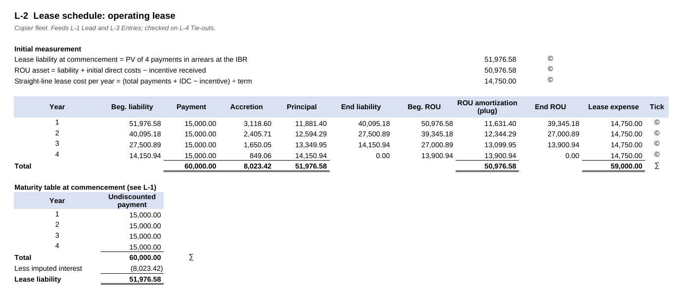
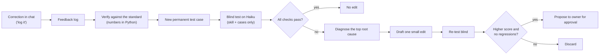

# Accounting skills for Claude

25 skills that teach Claude to do real accounting and tax work, from ASC 842 lease schedules and tax provisions to S corporation basis, state nexus and QuickBooks cleanup. They come with **Skill Lab**, a loop that tests a skill blind and only accepts an edit after it proves itself.

Built by Blaise Vastola, Master of Accounting (Penn State) and CPA candidate, working with Claude.

## Results

The flagship skill, `asc-842-lessee`, is graded against 21 test cases and 64 pass/fail checks. Every expected number is computed in code.

| Run | Test-taker | Score |
|---|---|---|
| Baseline, blind | Haiku (smallest model) | 62 / 64 |
| After one proven edit | Haiku | **64 / 64**, no regressions |
| Full suite | Opus | **64 / 64** |
| Answer key recomputed from first principles | `compute_key.py` | 38 / 38 numeric values match |

The baseline miss was a real one. The skill didn't say that a lessor-controlled extension always belongs in the lease term (Case 19). Leaving it out turns a 5-year term into 3 and understates the liability by 37% (27,232.48 instead of 43,294.77). Skill Lab wrote a one-line fix, re-tested it blind, and confirmed it fixed both checks without breaking any that passed before.

Testing on the smallest model is on purpose. A strong model fills a skill's gaps from its own knowledge and hides them; Haiku shows what the skill itself teaches.

### Tax skill pack

Four tax skills were built and tested the same way: blind on Haiku, with every expected answer computed in code. Two independent reviewers then recomputed all 82 cases and checked each rule against the Code, regulations and IRS instructions.

| Skill | Cases | Checks | First blind run | After fixes |
|---|---|---|---|---|
| `s-corp-basis` | 19 | 72 | 72 / 72 | **72 / 72** |
| `partnership-basis` | 20 | 63 | 60 / 63 | **63 / 63** |
| `form-1040-review` | 21 | 56 | 56 / 56 | **56 / 56** |
| `state-nexus` | 22 | 49 | 49 / 49 | **49 / 49** |

The partnership miss was real: the rule for debt on contributed property let the test-taker count the partner's share twice, overstating basis by 15,000 in one case. The review also caught a wrong entry in one answer key, which a passing score had hidden. Details are in [`RESULTS.md`](RESULTS.md) and [`review/`](review).

## See it work

[`examples/asc-842-lessee`](examples/asc-842-lessee) has the full client-file output for a copier fleet lease: classification memo, schedule, journal entries, current/noncurrent split, maturity table, reviewer flags and tie-outs. It also has the matching **Excel workpaper**, with live formulas, named inputs, tickmarks and a tie-out tab that reads ALL TIED.



## How Skill Lab works



The rules: one edit per run. The test-taker never sees the answer key. Every mistake becomes a permanent test, so a regression always shows up in the score. Nothing changes without the owner's approval. Details are in [`skill-lab/`](skill-lab).

## The library

| Skill | Standard | What it does |
|---|---|---|
| [asc-842-lessee](skills/asc-842-lessee/SKILL.md) | ASC 842 | Lease classification, PV, ROU asset, schedules, entries, modifications. **Tested in Skill Lab.** |
| [s-corp-basis](skills/s-corp-basis/SKILL.md) | IRC 1366-1368 | Shareholder stock and debt basis, loss limits, distributions, loan repayments. **Tested.** |
| [partnership-basis](skills/partnership-basis/SKILL.md) | IRC 704(d), 731-733, 752 | Partner outside basis, liability shifts, loss limits, distributions. **Tested.** |
| [form-1040-review](skills/form-1040-review/SKILL.md) | Form 1040 | Review of a prepared individual return: completeness, deductions, penalties, tie-outs. **Tested.** |
| [state-nexus](skills/state-nexus/SKILL.md) | P.L. 86-272, state law | Sales and income tax nexus, apportionment, throwback and throwout. **Tested.** |
| [asc-606-revenue](skills/asc-606-revenue/SKILL.md) | ASC 606 | Contracts, performance obligations, variable consideration, SSP allocation |
| [asc-740-tax-provision](skills/asc-740-tax-provision/SKILL.md) | ASC 740 | Current and deferred tax, valuation allowance, uncertain positions, ETR rec |
| [stock-compensation](skills/stock-compensation/SKILL.md) | ASC 718 | Options, RSUs, vesting, forfeitures, modifications, tax effects |
| [earnings-per-share](skills/earnings-per-share/SKILL.md) | ASC 260 | Basic and diluted EPS, treasury stock and if-converted methods |
| [equity-method](skills/equity-method/SKILL.md) | ASC 323 | Basis differences, investee income, intra-entity profit |
| [business-combinations](skills/business-combinations/SKILL.md) | ASC 805 | Purchase price allocation, goodwill, contingent consideration, NCI |
| [consolidation-intercompany](skills/consolidation-intercompany/SKILL.md) | ASC 810 | Eliminations, NCI, unrealized intercompany profit |
| [asset-impairment](skills/asset-impairment/SKILL.md) | ASC 350 / 360 | Long-lived assets, held for sale, goodwill testing |
| [bonds-debt](skills/bonds-debt/SKILL.md) | ASC 470 / 835 | Bond pricing, effective interest, extinguishments, modifications |
| [cash-flow-indirect](skills/cash-flow-indirect/SKILL.md) | ASC 230 | Indirect-method cash flow statement and net income reconciliation |
| [nonprofit-accounting](skills/nonprofit-accounting/SKILL.md) | ASC 958 | Net asset classes, contributions, releases, functional expenses |
| [governmental-accounting](skills/governmental-accounting/SKILL.md) | GASB | Fund types, modified accrual, government-wide reconciliation |
| [audit-sampling](skills/audit-sampling/SKILL.md) | AU-C 530 / AS 2315 | Attribute sampling, MUS, projecting misstatement |
| [journal-entry-review](skills/journal-entry-review/SKILL.md) | AU-C 240 / AS 2401 | JE screening for errors, control issues and fraud-risk indicators |
| [accounting-memo](skills/accounting-memo/SKILL.md) | — | Technical memos: issue, facts, guidance, alternatives, conclusion |
| [excel-workpaper](skills/excel-workpaper/SKILL.md) | — | Real .xlsx workpapers with live formulas, tie-outs and sign-off |
| [close-schedules](skills/close-schedules/SKILL.md) | — | Accruals, prepaid and deferred revenue, fixed asset roll-forwards |
| [flux-variance-analysis](skills/flux-variance-analysis/SKILL.md) | — | Period-over-period and budget-vs-actual flux, price/volume/mix |
| [bank-reconciliation](skills/bank-reconciliation/SKILL.md) | — | Bank-to-GL reconciliation and finding why cash doesn't tie |
| [quickbooks-cleanup](skills/quickbooks-cleanup/SKILL.md) | — | QuickBooks Online file diagnosis and catch-up bookkeeping |

Five skills have computed test suites under [`evals/`](evals): `asc-842-lessee` and the four tax skills. `asc-842-lessee` also runs in the weekly Skill Lab loop. Any other skill can be tested the same way, starting with at least 15 computed cases.

## Use the skills

Each folder under `skills/` is an Agent Skill: a `SKILL.md` with `name` and `description` frontmatter that tells Claude when to use it. Add one to Claude as a custom skill, or put it in a Claude Code skills folder (`.claude/skills/`).

## Check the numbers yourself

```bash
python evals/asc-842-lessee/compute_key.py --verify   # recompute all 38 numeric answer-key values
python evals/asc-842-lessee/grade.py --ids            # list the 64 checks
python examples/asc-842-lessee/build_example.py       # rebuild the sample deliverable
python examples/asc-842-lessee/build_workpaper.py     # rebuild the Excel workpaper (needs openpyxl)
```

## Scope

These skills prepare work for a reviewer. Yearly federal figures and state thresholds change, so the tax skills tell Claude to look them up, and their test cases state the figures they use. Judgment calls, such as the lease term, the discount rate and "reasonably certain" assessments, are flagged for sign-off and never decided silently. The facts in the examples are illustrative. This isn't accounting advice, and the project isn't affiliated with Anthropic.

## Contact

Blaise Vastola · [LinkedIn](https://www.linkedin.com/in/blaise-vastola/)
